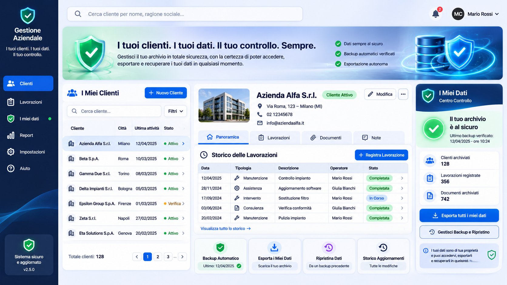

# Gestionale Impianti

**I tuoi clienti. I tuoi dati. Il tuo controllo. Sempre.**

Gestionale di clienti, impianti e storico dei lavori per installatori e manutentori termoidraulici. È un unico file HTML che funziona sul tuo computer, anche senza internet. I dati restano nel browser del tuo computer e puoi esportarli tutti, in qualunque momento, in formati aperti.



## Perché esiste

Chi usa un gestionale ha una paura precisa: *«Ogni volta che il software viene aggiornato perdo tutti i dati.»* Questo programma è costruito attorno a quella paura.

- **Nessun dato viene sovrascritto.** Quando modifichi un lavoro, la versione precedente resta conservata. Eliminare un documento o un lavoro lo sposta tra gli eliminati, da dove lo puoi ripristinare.
- **Ogni salvataggio viene verificato.** Dopo ogni scrittura l'archivio viene riletto e confrontato con quello in uso.
- **I backup sono verificati.** Il programma crea un backup ogni giorno, ogni 25 modifiche e prima di ogni operazione rischiosa. Ogni backup viene controllato con un'impronta digitale (SHA-256) e con un ripristino di prova.
- **Gli aggiornamenti sono protetti.** All'apertura di una versione nuova il programma crea e verifica un backup, converte i dati e controlla che il numero di clienti, lavori e documenti sia identico a prima.
- **Il verde è onesto.** Il riquadro «I Miei Dati» diventa verde solo quando tutti i controlli sono superati. Altrimenti dice cosa sistemare.

## Come si usa

1. Scarica `gestionale-impianti.html`.
2. Aprilo con Google Chrome o Microsoft Edge (doppio clic sul file).
3. Per aggiornarlo, sostituisci il file con la versione nuova e riaprilo: i dati restano.

## Cosa fa

| Area | Cosa trovi |
|---|---|
| **Clienti/Impianti** | Elenco, scheda cliente e, nella stessa schermata, anagrafica e impianto (matricola, contratto, prestazioni, installazione). |
| **Lavori eseguiti** | Lo storico del cliente, con le sigle **RT** (rapporto tecnico) e **DiCo** (dichiarazione di conformità). Avvisa se manca la DiCo su un'installazione. |
| **Documenti** | File singoli o un'intera cartella trascinata dal desktop. Gli originali restano dove sono e ogni copia viene verificata. I file già presenti non vengono duplicati. |
| **Azienda** | DURC, visura, polizza RC, patentino F-gas, POS e PSC, con scadenza e avviso 30 giorni prima. Quando rinnovi un documento, la versione vecchia resta conservata. |
| **I miei dati** | Stato dei controlli, backup, esportazione completa (ZIP con Excel, CSV, JSON, documenti originali e istruzioni), ripristino con anteprima, registro delle modifiche, operatori con PIN e codice di recupero. |

I PIN non sono mai salvati in chiaro: viene salvata solo la loro impronta (PBKDF2-SHA256). Le esportazioni non contengono credenziali.

## File del repository

| Percorso | Cosa contiene |
|---|---|
| `gestionale-impianti.html` | Il programma, versione 2.2.0. |
| `gestionale-impianti-v1.html` | Il prototipo di partenza (versione 1), usato per provare l'aggiornamento senza perdite. |
| `docs/immagini/` | L'immagine di riferimento e due foto del programma che il cliente usa oggi, con il desktop sfocato. |
| `test/test.mjs` | La prova automatica completa (70 controlli). |
| `test/file-di-prova/` | File finti usati dalla prova. |

## Prova automatica

```bash
npm install
npx playwright-core install chromium
npm test
```

La prova apre la versione 1, poi la 2, e verifica:

- l'aggiornamento senza perdite;
- clienti, lavori, documenti, cartelle e documenti dell'azienda;
- backup, esportazione e ripristino;
- PIN e codice di recupero;
- che la pagina non scorra di lato da 390 a 1680 pixel di larghezza.

## Dati di esempio

I clienti di esempio, gli indirizzi e i telefoni sono **inventati**.
